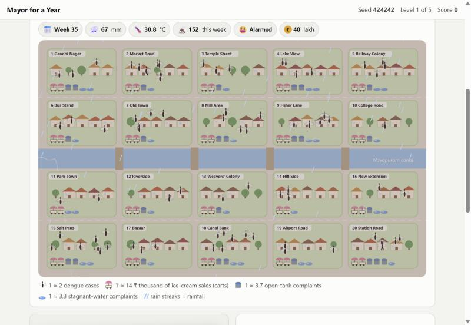
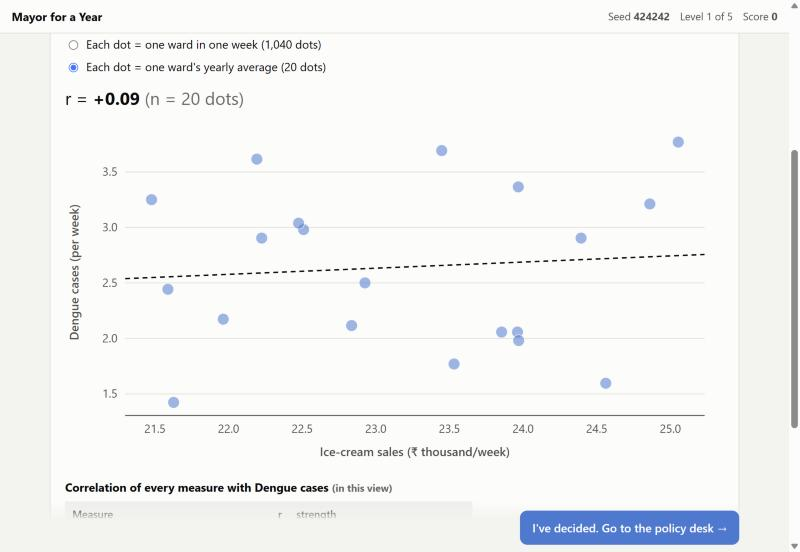
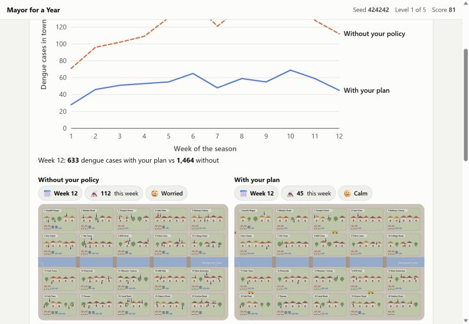
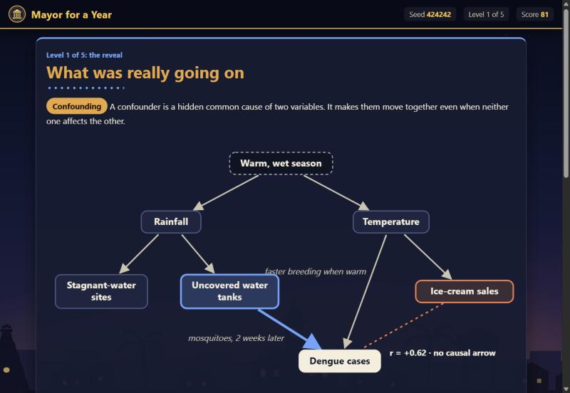
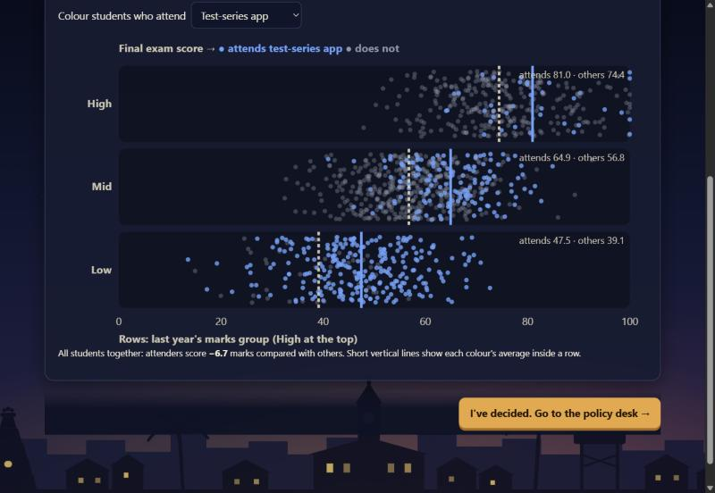
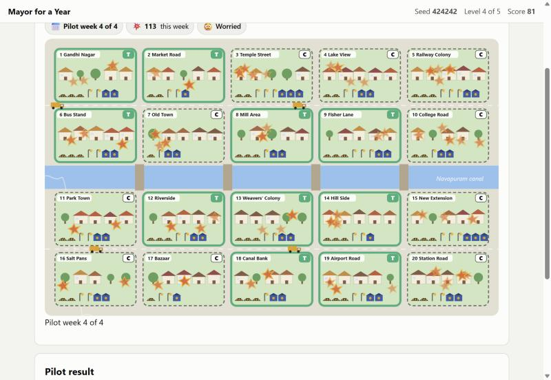
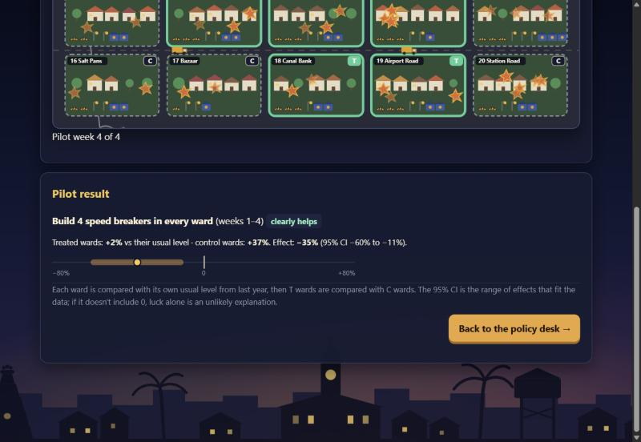

# Mayor for a Year

**A browser game that teaches _correlation does not imply causation_.**
You are the new mayor of Navapuram, a small Indian town. Each level gives you a problem, a budget and
a dashboard of town data. The data always points somewhere. Your job is to work out whether it points at the **cause**.

**▶ Play it here: <https://rohancarthik-max.github.io/mayor-game/>** (works on a laptop or phone, no install).

CS3006 Introduction to Data Science, Part B (learning game). **Report:** [`report/CS3006_MayorForAYear_Report.pdf`](report/CS3006_MayorForAYear_Report.pdf).



---

## How this meets the marking criteria

| Criterion | Where to find it |
|---|---|
| **Concept coverage & correctness** (1.5) | Four clearly stated concepts (confounding, reverse causation, Simpson's paradox, randomised experiments), each with its own level, a definition on the reveal screen and a [causal diagram](docs/design.md). [Learning objectives](#learning-objectives) are on the start screen and below. |
| **Game design & learning loop** (1.5) | Clear goal, budget and score per level. Loop: explore → decide → simulate → true impact → reveal. Your decision changes the simulated outcome. Each level unlocks a tool, and Level 5 tests transfer with new stories under budget pressure. It is not a quiz; the optional quiz only *measures* learning. |
| **Implementation** (1) | A hidden structural causal model generates fresh data every game. Every chart and number is computed live, true impact uses common random numbers, and every game is replayable from its seed. Plain HTML/JS: [runs by double-click](#how-to-run). **44 automated tests** ([`tests/sim.test.js`](tests/sim.test.js)). |
| **Documentation & evidence of learning** (1) | This README (how to play, objectives, how it works), [design notes](docs/design.md), built-in pre/post quiz, decision logging, feedback form, and a [summary script](tools/summarize_logs.py) for the [playtest results](#playtest-results). |

## The concept

Two things can move together without one causing the other. In the game you meet the four main ways this happens:

| Level | Story | The trap | Concept | Tool it unlocks |
|---|---|---|---|---|
| 1 | Dengue season | Ice-cream sales track dengue more closely than anything else. | **Confounding**: the season drives both | Town view, ward heatmap, time series, scatter + r, data table |
| 2 | The clinic paradox | Wards with more clinics have more fever, so closing clinics looks like a saving. | **Reverse causation**: fever causes clinics | *What changed first?* (event study) |
| 3 | Coaching centres | Students in a programme score *lower* overall. | **Simpson's paradox**: weak students join, but inside every group the programme helps | Class view, compare averages, split by group |
| 4 | Road accidents | All three road measures go with *more* accidents; the main cause isn't in the data. | **Hidden confounder → randomised experiment** | Randomised pilot (coin-toss wards, 95% CI) |
| 5 | Final term | Three new stories (diarrhoea vs cold drinks, thefts vs police posts, school absence) with one shared budget. | **When is an experiment worth it?** | Everything |

## Learning objectives

After playing, a learner should be able to:

1. Explain why a strong correlation does not show causation.
2. Recognise confounding, reverse causation and Simpson's paradox in data.
3. Use stratification (comparing like with like) to control for a confounder.
4. Explain why randomised experiments establish causation.

## How to play

1. **Start.** Enter a player tag (optional) and a town seed. The same seed always builds the same town. A 3-question warm-up quiz is optional.
2. **Read the brief.** Dr. Asha, your advisor, explains the problem; the newspaper pushes the tempting answer; the town replays last year.
3. **Explore the data** with the tools unlocked so far: watch the town week by week, compare wards, plot any two measures, and (later) check what changed first or split by group.
4. **Fund one policy** at the policy desk. From Level 4 you can first run a **randomised pilot**: a coin decides which 10 wards get the policy for 4 weeks, and you see the effect with a 95% confidence interval.
5. **Watch the season.** The town is simulated twice, with and without your policy, using the same weather and luck. The gap is your **true impact**. You get a score, stars and badges for good detective habits.
6. **See the reveal**: the hidden causal diagram animates in, the trap is explained in plain words, and a table shows what the data suggested for every option vs what actually happened.

**Scoring** (per problem, out of 100): 70 × your true impact ÷ the best possible impact, plus 30 × the share of budget left, minus 20 × the share wasted on a policy that didn't help.

| | |
|---|---|
|  Comparing wards' yearly averages: ice-cream's link with dengue disappears (r = +0.09). |  The season runs twice: with your plan and without it. |
|  The reveal: the hidden causal diagram. |  Level 3: attenders score 6.7 marks lower overall, but higher in every row. |
|  Level 4: a coin toss picks treated (T) and control (C) wards. |  The pilot's result with a 95% confidence interval. |

## How it works

**A hidden town model.** Each level is a *structural causal model*: a small set of equations where every
variable is computed from its true causes plus random noise, for 20 wards × 52 weeks (Level 3: 1,200 students).
For example, in Level 1:

```
rain        = season(week) × ward wetness + noise
breeding    = ward drainage × rain + noise           (one of two site types, chosen at random)
ice-cream   = ward base + k × (temperature − 25) + noise
dengue      ~ Poisson(b0 + β × breeding two weeks earlier × warmth)
```

Ice-cream has no arrow into dengue. It only shares a cause (the season). The full equations and diagrams for every level are in [`docs/design.md`](docs/design.md).

**Nothing is hard-coded.** Each game draws new parameters and, where possible, shuffles which candidate is the real
cause. The world is regenerated until the level's trap appears (for example, "ice-cream must be the strongest
correlate"). The noise was tuned so that most random worlds already contain the trap, so players see typical worlds.
Every correlation, plot, split and confidence interval is computed live from that data.

**True impact.** A policy is an intervention: it sets something in the model (e.g. ice-cream sales = 0). All future
randomness is drawn *once*, and every policy is simulated on the same random numbers (*common random numbers*). So
"with minus without" is exactly the policy's effect. A policy on a non-cause scores exactly 0, and the tests check this.

**Randomised pilots.** Treated wards are chosen by a seeded coin toss. Each ward's outcome during the pilot is
compared with its own usual level, then treated vs control wards are compared with a Welch 95% confidence interval.
Over 200 test worlds the estimate is unbiased and the interval contains the true effect about 95% of the time.

**Replayable.** A seeded random-number generator (mulberry32) means the seed on screen rebuilds the exact same game.

## How to run

- **Double-click `index.html`.** It runs offline in any modern browser, with no install, build step or internet.
  (It uses plain `<script>` files, not ES modules, because browsers block modules on `file://`.)
- Or serve the folder: `python -m http.server 8000` and open <http://localhost:8000>.
- Online: <https://rohancarthik-max.github.io/mayor-game/> (GitHub Pages, served straight from this repo).

## How to run the tests

Needs Node.js 18 or newer, and no packages:

```bash
node --test
```

The 44 tests load the same files the browser loads and check, for every level (including the Level 5 versions):
worlds are replayable from their seed; the trap holds in 150 generated worlds; worlds are typical (few
rejection tries); the real cause is shuffled; policies on non-causes have **exactly zero** effect; harmful
policies really harm and the best policy really is best; the randomised pilot is unbiased with ~95% CI coverage;
and the statistics helpers match known values (Pearson r, t-table quantiles, Welch CI).

`node tools/validation_stats.js` recomputes the validation numbers quoted in the report (trap rates over 500 raw
worlds, 2,400 zero-effect checks, pilot bias and confidence-interval coverage), with fixed seeds.

## Playtest results

Peer playtest sessions were not run within the project timeline. Everything needed for them is built and tested:
the in-game warm-up and check-out quiz, decision logging, the feedback form, the protocol in
[`docs/playtest/`](docs/playtest/README.md) and the summary script below.

Every player's downloaded log goes in `docs/playtest/logs/`, then:

```bash
python tools/summarize_logs.py
```

This writes `docs/playtest/summary.md` (trap-fall rate in Level 1 vs Level 5, quiz before vs after, ratings,
comments) and `docs/playtest/playtest_chart.png`.

## Project structure

```
index.html            the game (open this)
css/style.css         layout, colour tokens (light + dark), animations
js/rng.js             seeded random numbers, Poisson from a given uniform
js/stats.js           mean, sd, Pearson r, Welch CI, event study
js/scm/common.js      rejection sampling, common-random-numbers evaluation, scoring, pilots
js/scm/l1_dengue.js   confounding model (Level 1, and Level 5a theme)
js/scm/l2_clinics.js  reverse-causation model (Level 2, and Level 5b theme)
js/scm/l3_coaching.js Simpson's-paradox model (Level 3)
js/scm/l4_roads.js    hidden-confounder model (Level 4, and Level 5c theme)
js/levels.js          stories, tools, diagrams and explanations per level
js/charts.js js/town.js js/fx.js   SVG charts, the living town, effects
js/ui.js js/quiz.js js/log.js      screens, quiz questions, playtest logging
tests/sim.test.js     simulation tests (node --test)
tools/summarize_logs.py            combine players' logs into a summary + chart
tools/validation_stats.js          recompute the report's validation numbers
report/               the project report (PDF) and its LaTeX source
docs/design.md        causal diagram and equations of every level
docs/playtest/        protocol, observation notes, logs and summary
```
