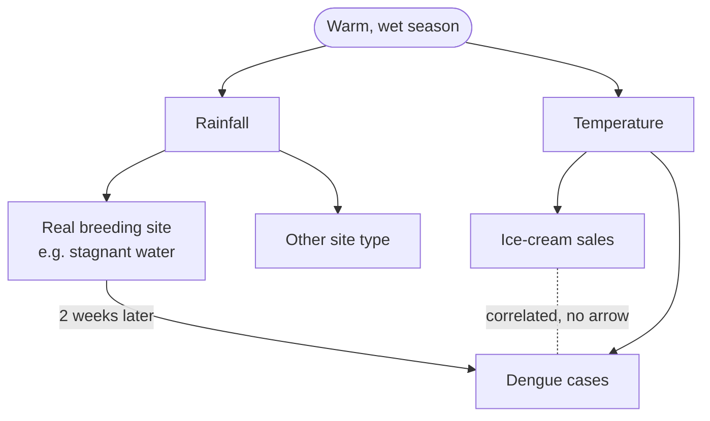
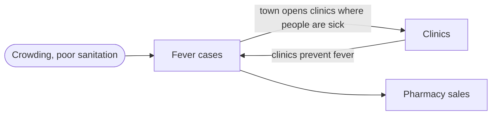
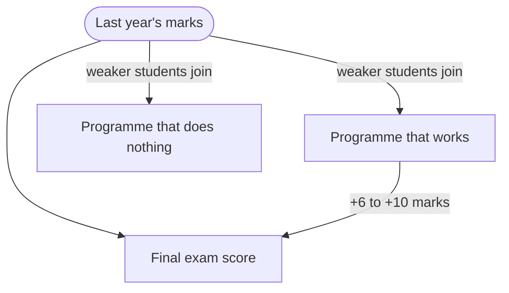
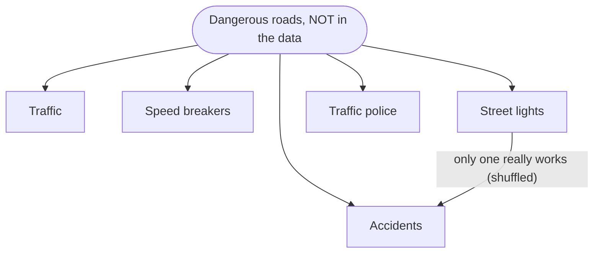

# Design notes: the hidden causal model of each level

Every level is a **structural causal model (SCM)**: a small set of equations where each
variable is computed from its true causes plus random noise. The player never sees the
equations, only the data they produce. Arrows below mean "is a cause of".

Common to all levels:

- **Fresh world every game.** Parameters (effect sizes, season timing, ward traits) are drawn
  from ranges, and where possible the *role* of the candidates is shuffled (which site type
  is the real cause, which programme works, which road measure works).
- **Rejection sampling.** A world is regenerated until the level's trap condition holds.
  The noise levels were tuned so that 70–99% of random worlds contain the trap anyway, so the
  worlds players see are typical, not rare cherry-picked ones (a test checks this).
- **Common random numbers (CRN).** All the future randomness is drawn once. Every policy is
  simulated on exactly the same randomness, so "with policy minus without policy" is the
  policy's true effect and nothing else. Counts use inverse-CDF Poisson sampling from stored
  uniforms, so a policy on a non-cause gives an impact of **exactly 0**.
- **Seeded PRNG** (mulberry32). Seed `S` + level id gives the same town every time.

---

## Level 1: Dengue season (confounding)

Equations (w = ward, t = week, e = N(0,1) noise):

| Variable | Equation |
|---|---|
| season `S(t)` | bell curve peaking at a random week (26–34) |
| temp | `tBase + tAmp*S(t) + noise` |
| rain | `rainAmp*S(t)*wet_w + noise` |
| siteA, siteB | `d_w * rain/10 + noise` (one is the real cause, shuffled) |
| ice-cream | `base_w + perDeg*(temp-25) + noise` |
| complaints | `round(report_w * site + noise)`, which is what the town records |
| dengue | `Poisson(b0 + beta * siteCAUSE[t-2] * (temp-20)/10)` |

**Why the trap works.** Ice-cream and dengue both follow the season, so across ward-weeks
ice-cream has the strongest correlation with dengue (trap condition: r > 0.5 and beats both
complaint columns by 0.05). The real cause is measured only through complaints (noisy, and
reported at different rates per ward) and acts two weeks later, so its same-week r is lower.

**Why it is beatable.** Every ward shares the season. Comparing wards' yearly averages
cancels the season out; there the real cause's complaints track dengue (r > 0.4) and
ice-cream doesn't (checked in the trap condition). The Town view and ward heatmap show the
same thing visually: mosquitoes and the real site type cluster in the same wards.

**Level 5a** reuses this model with a new story: diarrhoea, cold-drink sales, sewers/pipes/dumps.

---

## Level 2: The clinic paradox (reverse causation)

| Variable | Equation |
|---|---|
| risk_w | hidden, 0.4–2.0 |
| fever | `Poisson(a * risk_w * (0.4 + S(t)) * exp(-gamma * clinics[t-1]))`, gamma 0.05–0.09 |
| clinics | +1 with probability 0.2–0.3 when the last 4 weeks averaged above a threshold; start level grows with risk |
| pharmacy | `20 + 3.5 * fever + noise` |

**Why the trap works.** The town *responds* to sickness by opening clinics, so sick wards
end up with more clinics (trap: r > 0.4 across wards' yearly averages), even though each clinic
*reduces* fever. Closing clinics looks like a free ₹10 lakh but raises fever.
Pharmacy sales are also caused *by* fever, so capping them does exactly nothing.

**Why it is beatable.** The "What changed first?" tool lines up every week a clinic opened
and shows fever was already well above the ward's usual level (trap condition: > 115%)
in the 3 weeks *before*. Fever came first.

**Level 5b** reuses the model: thefts, police posts, lock & CCTV sales.

---

## Level 3: Coaching centres (Simpson's paradox)

One row per student (1,200 students):

| Variable | Equation |
|---|---|
| prior | `N(55, 16)` |
| group | Low < 45 ≤ Mid < 65 ≤ High |
| joins A / B | probability 0.75–0.90 (Low), 0.20–0.35 (Mid), 0.04–0.10 (High) |
| final | `8 + 0.9*prior + tauA*A + tauB*B + 8e`, one tau is 6–10, the other 0 (shuffled) |

**Why the trap works.** Mostly weak students join, so attenders of *both* programmes score
lower overall (trap: the real programme's attenders score 3+ marks lower overall), yet the
real programme helps by 1.5+ marks inside **every** prior-marks group.

**Why it is beatable.** "Split by group" on prior-marks group compares like with like
(stratification). The class view shows it too: in each row the blue dots sit to the right.

---

## Level 4: Road accidents (hidden confounder → randomised experiment)

| Variable | Equation |
|---|---|
| danger_w | hidden, 0.6–1.6 |
| traffic | `1000*(0.5*danger + 0.5*other)`, only partly danger |
| each measure X_k | placed where roads were dangerous: grows with danger + noise |
| accidents | `Poisson(base * danger * (0.7 + 0.6 S(t)) * exp(-theta*(X_cause - mean)))`, roll-out cuts 25–40% |

**Why the trap works.** All three measures were put on dangerous roads, so all three go
with *more* accidents (trap: all r > 0.2 across wards, and the strongest is not the real
cause). Danger is not in the data, so no split or plot can remove it.

**Why it is beatable.** The randomised pilot: a seeded coin toss puts 10 wards in T and 10 in C
for 4 weeks of the season. Each ward is compared with its own usual level, then T vs C with
a Welch 95% confidence interval. Because a coin chose, danger is balanced between the groups
on average. Tests over 200 worlds show the estimate is unbiased and the 95% CI contains
the true effect ~95% of the time.

**Level 5c** reuses the model: children absent from school, with school buses, meal upgrades
and uniform kits.

---

## Level 5: Final term (when is an experiment worth it?)

Three new problems (5a confounding, 5b reverse causation, 5c hidden confounder) share one
**₹90 lakh** budget; a pilot is available in each (₹5 lakh, 4 weeks). Three roll-outs plus three
pilots cost more than ₹90 lakh, so the player must decide where the data already answers the
question (5a: ward averages; 5b: "what changed first?") and where only an experiment can (5c).
The new stories test **transfer**: avoiding the trap here means the idea was learned, not
the answer.

## Scoring

Per problem, out of 100: `70 × (true impact ÷ best possible impact)` + `30 × share of the budget
left` − `20 × share wasted on a policy that didn't help`, floored at 0. The best possible impact is
found by simulating every option with the same random numbers. Pilot spending is not counted as
waste (it buys information) but it does use budget and weeks.
